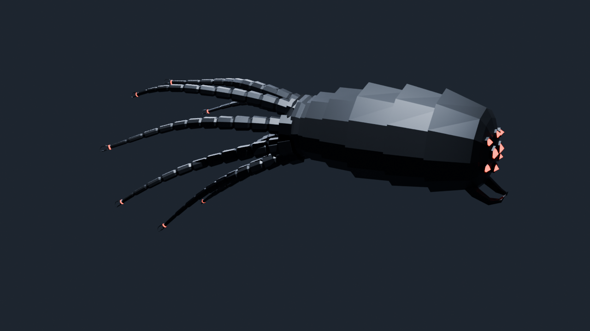

# Mech Sentinel Swarm (Mass Entity + GAS + MassReplication)

A Matrix-style swarm of squid-like "sentinels" built on **Mass Entity**. Thousands of flyers avoid each other,
pick targets from a **shared fragment** (a targeting board), switch to an **attack state** in range, are drawn with
**instanced static meshes**, take hits through **simple collision capsules**, and resolve health / armor / buffs /
stuns with the **Gameplay Ability System**, while all the data lives in Mass. It is **server authoritative** and
replicated with the engine's **MassReplication**.

All code is in `Source/Aura/Public/MechSwarm` and `Source/Aura/Private/MechSwarm`.

---

## Contents

1. [Quick setup in the editor](#1-quick-setup-in-the-editor)
   * [Spawning sentinels in a level (worked example)](#spawning-sentinels-in-a-level-worked-example)
2. [Architecture at a glance](#2-architecture-at-a-glance)
3. [Folder and file map](#3-folder-and-file-map)
4. [Structural dependencies](#4-structural-dependencies)
5. [What a sentinel entity is made of](#5-what-a-sentinel-entity-is-made-of)
6. [One frame, step by step](#6-one-frame-step-by-step)
7. [Targeting through the shared fragment](#7-targeting-through-the-shared-fragment)
8. [Combat data flow (GAS logic, Mass storage)](#8-combat-data-flow-gas-logic-mass-storage)
9. [Replication data flow](#9-replication-data-flow)
10. [Waves](#10-waves)
11. [Hitting sentinels from actors (the capsule function)](#11-hitting-sentinels-from-actors-the-capsule-function)
    * [Gun shots (GA_GunShoot)](#gun-shots-ga_gunshoot)
12. [ISM representation and the material](#12-ism-representation-and-the-material)
13. [_Copy classes and their engine counterparts](#13-_copy-classes-and-their-engine-counterparts)
14. [Design choices, deviations and limitations](#14-design-choices-deviations-and-limitations)
15. [Sentinel model and Niagara ribbon tentacles](#15-sentinel-model-and-niagara-ribbon-tentacles)
    * [Tentacle motion and its settings](#tentacle-motion-and-its-settings)

---

## 1. Quick setup in the editor

The `MassGameplay` plugin is enabled in `Aura.uproject`, and the Mass modules are added in `Aura.Build.cs`.

1. **Gameplay effects.** Damage needs no assets: the rules default to two built-in C++ effects
   (`MechSentinelDefaultEffects.h`), shown in effect pickers as *Mech Sentinel Damage (built-in)* and
   *Mech Sentinel Attack (built-in)*. Blueprint `GameplayEffect` assets are for replacing them, and for stuns, shields
   and buffs:
   | Asset (suggested name) | Duration | What to put in it |
   |---|---|---|
   | `GE_SentinelDamage` (optional, same as the built-in `UMechSentinelDamageEffect`) | Instant | Executions: `ExecCalc_SentinelDamage`. No modifiers are needed. |
   | `GE_SentinelAttack` (optional, sentinel hits a player; same as the built-in `UMechSentinelAttackEffect`) | Instant | Either a modifier on `MyAttributeSet.IncomingDamage`, Add, magnitude **Set by Caller** tag `SetDamageByCaller`, or Executions: the project's `ExecCalc_Damage` (adds its block / crit rolls). |
   | `GE_SentinelStun` (optional) | Has Duration, e.g. 2 s | Component "Grant Tags to Target Actor": `State.Sentinel.Stunned` |
   | `GE_SentinelShield` (optional) | Has Duration | Grant `State.Sentinel.Shielded` (damage x `ShieldedDamageMultiplier`) |
   | Buffs / debuffs (optional) | Duration / Infinite | Modifiers on `MechSentinelAttributeSet.Armor`, `AttackDamage`, `AttackSpeed`, `MoveSpeedMultiplier` |
2. **Rules asset** (optional): create a `MechSentinelSwarmRules` data asset to tune the caps or pick other effects
   (`DefaultSentinelDamageEffect`, `SentinelAttackEffect`; they start as the built-in ones). Assign it on your GameMode
   Blueprint (`BP_MyGameMode` > **Mech Sentinels** > **Sentinel Swarm Rules**). Without one the C++ defaults apply.
3. **Mesh / material**: run `SourceArt/MechSentinel/ue_import_mech_sentinel.py` in the editor. It imports the low-poly
   sentinel (`SM_MechSentinel_Head`, `SM_MechSentinel_Far` with baked tentacles, the tentacle and claw tip), creates the
   tentacle ribbon material and the body / eye materials (they read `PerInstanceCustomData` 0..3, see
   [section 12](#12-ism-representation-and-the-material)) and assigns them to the mesh slots. For the Niagara tentacles,
   build `NS_MechSentinelTentacles` with the recipe in [section 15](#15-sentinel-model-and-niagara-ribbon-tentacles)
   (already built and committed under `Content/MechSentinel/FX`).
4. **Entity config**: create a `MassEntityConfigAsset` (for example `DA_SentinelConfig`) with these traits:
   | Trait | Settings |
   |---|---|
   | **Mech Sentinel** | `SwarmGroup`, attribute defaults, shared `MovementSpeed`, `Parameters` (attack range, orbit, capsule size, death fall) |
   | **Movement (Copy)** | max speed / acceleration |
   | **Avoidance (Copy)** | separation distance / strength, prediction time |
   | **Smooth Orientation (Copy)** | turn speed, max pitch, banking |
   | **Visualization ISM (Copy)** | Mesh `SM_MechSentinel_Head`, LowLODMesh `SM_MechSentinel_Far`, materials, `NumCustomDataFloats = 4`, LOD distances |
   | **Mech Sentinel Tentacles (Niagara)** (optional) | Niagara System `NS_MechSentinelTentacles`, budget (`MaxRiggedSentinels`, `MaxDistance`), sway / stiffness |
   | **Replication** (engine trait) | **Bubble Info Class = `MechSentinelClientBubbleInfo`**, **Replicator Class = `MechSentinelReplicator`**. Suggested LOD distances 0 / 2500 / 7000 / 20000, max count per viewer 150 / 300 / 1000, update interval 0.1 / 0.2 / 0.4 / 0.5 |
   If the Replication trait points at other classes, the swarm subsystem logs an error and ignores the config (instead of the engine asserting).
5. **Spawner**: place a `MechSentinelWaveSpawner` in the level (it must be **level-placed**, so clients build the same
   entity template before replicated sentinels arrive). Assign `EntityConfig`, edit `Waves`, `CountMultiplier`, caps
   and `FallbackTargets`.
6. **Weapons**: the project's gun ability (`GA_GunShoot`) already damages sentinels along each shot, see
   [section 11](#11-hitting-sentinels-from-actors-the-capsule-function). For other weapons add a
   `MechSentinelHitCapsuleComponent` to projectiles, or call `ApplyDamageToSentinelsInCapsule` from abilities / melee
   (server, outside the Mass phases: [section 6](#6-one-frame-step-by-step)).
7. Play as **listen server + clients** (or a dedicated server). Standalone works too. `Config/DefaultMass.ini` swaps
   the engine's replication processor for the project's ([section 9](#9-replication-data-flow)); keep it.

### Spawning sentinels in a level (worked example)

Everything below is ready-made under `/Game/MechSentinel` (built by `SourceArt/MechSentinel/ue_setup_mech_sentinel_demo.py`):

| Asset | What it is |
|---|---|
| `Demo/L_MechSentinelDemo` | open it and press Play: a 200 m floor with nav mesh, a PlayerStart and one configured spawner |
| `Demo/BP_MechSentinelDemoGameMode` | child of the project's GameMode with the rules below assigned (used by the demo map only) |
| `Data/DA_MechSentinelConfig` | the entity config (traits and attributes below) |
| `Data/DA_MechSentinelSwarmRules` | global rules: damage effects, 10 attackers per player, 1500 alive at most |
| `GAS/GE_SentinelDamage`, `GE_SentinelAttack`, `GE_SentinelStun` | damage taken, damage dealt to players, a 2 s stun |

**In your own level:**

1. Assign `DA_MechSentinelSwarmRules` on the GameMode Blueprint the level uses (**Mech Sentinels** >
   **Sentinel Swarm Rules**). Without it the C++ defaults apply: the built-in damage effects (damage still works both
   ways), 14 attackers per player and 1500 alive at most.
2. Place Actors > search **Mech Sentinel Wave Spawner**, drop it where the swarm should appear, about 8 m above the
   ground. Sentinels spawn inside `SpawnExtent` (an ellipsoid, 15 x 15 x 4 m by default) around it.
3. Details > **Mech Sentinels** > `EntityConfig` = `DA_MechSentinelConfig`.
4. Fill **Waves** and the spawner settings (tables below), then Play. For multiplayer use Play As Listen Server; the
   spawner must stay level-placed (clients build the entity template from it).

**How many and how fast** (one row per element of `Waves`; counts are multiplied by `CountMultiplier`):

| Wave field | Meaning | W1 | W2 | W3 | W4 |
|---|---|---|---|---|---|
| `Count` | sentinels in the wave | 12 | 30 | 60 | 120 |
| `DelayBefore` | countdown before the wave starts (s) | 3 | 5 | 6 | 8 |
| `SpawnDuration` | the wave is spawned evenly over this time (s); rate = Count / SpawnDuration | 4 | 6 | 8 | 10 |
| `TimeLimit` | with `AdvanceMode` OnTimer / ClearedOrTimer: seconds until the next wave (0 = never by timer) | 45 | 50 | 60 | 75 |
| `HealthMultiplier` | x the config's MaxHealth | 1 | 1.25 | 1.5 | 2 |
| `ArmorMultiplier` | x the config's Armor | 1 | 1.25 | 1.5 | 2 |
| `DamageMultiplier` | x the config's AttackDamage | 1 | 1 | 1.2 | 1.5 |
| `AttackSpeedMultiplier` | x the config's AttackSpeed | 1 | 1 | 1.1 | 1.2 |
| `MoveSpeedMultiplier` | x the swarm's MovementSpeed (per sentinel attribute) | 1 | 1 | 1.05 | 1.1 |

| Spawner setting | Demo value | Meaning |
|---|---|---|
| `AdvanceMode` | ClearedOrTimer | next wave when every sentinel of the wave is dead, or after `TimeLimit` (WhenCleared / OnTimer also exist) |
| `bAutoStart` | on | starts wave 1 on BeginPlay (otherwise call `StartWaves`) |
| `bRepeatLastWave` | on | after W4, repeat it forever, each time `+ExtraCountPerRepeat` sentinels and `x StatScalePerRepeat` health, armor and damage |
| `ExtraCountPerRepeat` / `StatScalePerRepeat` | 25 / 1.1 | |
| `CountMultiplier` | 1 | global amount knob (`SetCountMultiplier` at runtime, also re-plans the wave in progress) |
| `MaxAlive` | 400 | this spawner waits while 400 of its sentinels are alive (the rules cap all spawners at 1500) |
| `SpawnBatchSize` | 25 | at most 25 entities created per frame |
| `SpawnExtent` | (1500, 1500, 400) cm | spawn ellipsoid around the spawner |
| `FallbackTargets`, `bSpawnerIsFallbackTarget` | none, on | where sentinels go when every player already has `MaxAttackersPerPlayer` attackers (they circle the spawner) |

**Attributes.** The base values are on `DA_MechSentinelConfig` > **Mech Sentinel** trait: `Attributes` (MaxHealth 120,
Armor 4, AttackDamage 3, AttackSpeed 0.6 attacks/s) and the shared `MovementSpeed` (900 cm/s). Each wave multiplies them
when a sentinel is spawned, which gives (armor mitigation = 0.06 x Armor / (1 + 0.06 x Armor)):

| Wave | Count | Spawned at | Next wave | MaxHealth | Armor (damage taken -) | AttackDamage | Attacks/s | Speed (cm/s) |
|---|---|---|---|---|---|---|---|---|
| 1 | 12 | 3 / s for 4 s | cleared or 45 s | 120 | 4 (-19%) | 3 | 0.6 | 900 |
| 2 | 30 | 5 / s for 6 s | cleared or 50 s | 150 | 5 (-23%) | 3 | 0.6 | 900 |
| 3 | 60 | 7.5 / s for 8 s | cleared or 60 s | 180 | 6 (-26%) | 3.6 | 0.66 | 945 |
| 4 | 120 | 12 / s for 10 s | cleared or 75 s | 240 | 8 (-32%) | 4.5 | 0.72 | 990 |
| 5 (W4 repeat 1) | 145 | 14.5 / s for 10 s | cleared or 75 s | 264 | 8.8 (-35%) | 4.95 | 0.72 | 990 |
| 6 (W4 repeat 2) | 170 | 17 / s for 10 s | cleared or 75 s | 290 | 9.7 (-37%) | 5.4 | 0.72 | 990 |

At most `MaxAttackersPerPlayer` (10) sentinels attack one player; with the W1 values that is up to 10 x 3 x 0.6 = 18
damage per second before the player's own defences, 32 per second in W4. A sentinel attacks inside `AttackRange`
(450 cm) and orbits its player at `OrbitRadius` (320 cm).

**At runtime** (spawner, server, Blueprint callable): `StartWaves`, `StopWaves`, `StartNextWave`, `SetCountMultiplier`,
`SetWaveCount`, `SpawnSentinelsNow(n)`, `DespawnAll` (these two are carried out by the spawner's tick later the same
frame, and `DespawnAll` cancels spawn requests made before it); read `GetCurrentWaveNumber`, `GetCurrentWaveTotal`,
`GetAliveCount`, `GetRemainingToSpawn`; bind `OnWaveStarted(wave, count)` / `OnWaveCleared(wave)`. Buffs and debuffs
are gameplay effects on the sentinels (modifiers on `MechSentinelAttributeSet.Armor`, `AttackDamage`, `AttackSpeed`,
`MoveSpeedMultiplier`, or `State.Sentinel.Stunned` / `Shielded` tags); the swarm speed is
`UMechSentinelSwarmSubsystem::SetSwarmMovementSpeed`.

**Shooting them**: `GA_GunShoot` deals `SentinelDamage` (40) to the first sentinel on the shot's line. After armor that
is 4 shots per sentinel in W1, 5 in W2, 7 in W3 and 9 in W4. Projectiles need a `MechSentinelHitCapsuleComponent`
([section 11](#11-hitting-sentinels-from-actors-the-capsule-function)).

---

## 2. Architecture at a glance

```
                         +-----------------------------------------------+
                         |  AMyGameMode (server only)                    |
                         |   SentinelSwarmRules  (UMechSentinelSwarmRules)|  <- global data (no DeveloperSettings)
                         +-----------------------+-----------------------+
                                                 | read on BeginPlay
                                                 v
+----------------------------+   registers   +-----------------------------------------------+
| AMechSentinelWaveSpawner   |-------------->|  UMechSentinelSwarmSubsystem (UWorldSubsystem) |
|  (level placed, replicated)|  config,      |   - rules, player targets, fallback points     |
|  waves, counts, caps       |  fallbacks    |   - template bootstrap + config validation      |
+-------------+--------------+               |   - GAS bridge  ----------------------------+  |
              | SpawnEntities                |   - capsule collision hash + queries        |  |
              v                              +---------------^--------------------+--------+--+
+-------------------------------------------------------+    | hits / effects     | Load/Apply/
|                MASS ENTITY  (all sentinel data)        |    |                    | ReadBack
|  fragments: transform, velocity, attributes, state,    |    |                    v
|             target, attack, GAS (tags + effects)       |  +-+-----------------------------+
|  shared:    targeting board, movement speed            |  | AMechSentinelGASProxy (server) |
|  processors: effects, targeting, steering, avoidance,  |  |  ASC + MechSentinelAttributeSet|
|              forces, movement, orientation, attack,    |  |  ExecCalc_SentinelDamage       |
|              death, collision hash, visuals, smoothing |  |  (combat math only, no storage)|
+---------+-----------------------------+---------------+  +--------------------------------+
          |                             |
          | UMechSentinelReplication-   | UMassUpdateISMProcessor_Copy
          |   Processor (section 9)     | (where frames are rendered)
          | + UMechSentinelReplicator   |
          v                             v
+----------------------------+   +-----------------------------------------+
| AMechSentinelClientBubble- |   | AMassVisualizer_Copy                     |
| Info (one per client)      |   |  UMassVisualizationComponent_Copy        |
|  fast array of agents      |   |   UInstancedStaticMeshComponent per mesh |
+-------------+--------------+   +-----------------------------------------+
              | network
              v
   client: bubble spawns / updates / destroys client entities -> smoothing -> ISM
```

**Who owns what**

| Concern | Owner |
|---|---|
| Health, MaxHealth, Armor, AttackDamage, AttackSpeed, MoveSpeedMultiplier (per entity) | Mass `FMechSentinelAttributesFragment` |
| MovementSpeed (shared by the whole swarm group) | Mass shared fragment `FMechSentinelSharedAttributesFragment` |
| Active buffs / debuffs / stun / shield, owned gameplay tags | Mass `FMechSentinelGASFragment` (stored), GAS (evaluated) |
| Damage math, armor mitigation, Shielded / Dead rules, modifiers, tag requirements | GAS (`AMechSentinelGASProxy`, `ExecCalc_SentinelDamage`, `UMechSentinelAttributeSet`) |
| Movement, avoidance, LOD, representation, collision queries, scale | Mass |
| Stunned / Dead / Attacking | Gameplay tags in GAS, mirrored as Mass tags for queries |

---

## 3. Folder and file map

```
Source/Aura/{Public,Private}/MechSwarm/
|
+-- Core/
|   MechSwarmProcessorGroups.h      processor group names (Combat, LODCollector, Representation)
|   MechSentinelSwarmRules.h/.cpp   UMechSentinelSwarmRules: global rules (data asset, referenced by AMyGameMode)
|   MechSentinelSwarmSubsystem.h/.cpp  the hub: rules, targets, templates, GAS bridge, collision hash
|
+-- Sentinel/
|   MechSentinelFragments.h         every sentinel fragment, tag and shared fragment
|   MechSentinelTrait.h/.cpp        "Mech Sentinel" trait
|   MechSentinelProcessors.h        declarations of the sentinel processors
|   MechSentinelBehaviorProcessors.cpp   effects, target selection, steering
|   MechSentinelCombatProcessors.cpp     attack, death, collision hash
|   MechSentinelClientProcessors.cpp     visual data (ISM custom data), net smoothing
|
+-- GAS/
|   MechSentinelTags.h/.cpp         State.Sentinel.{Stunned,Shielded,Dead,Attacking}, Unit.Sentinel
|   MechSentinelAttributeSet.h/.cpp attributes + IncomingDamage meta attribute
|   ExecCalc_SentinelDamage.h/.cpp  armor mitigation
|   MechSentinelDefaultEffects.h/.cpp  built-in damage effects, the rules' defaults (sentinel hit, sentinel attack)
|   MechSentinelGASProxy.h/.cpp     flyweight ASC actor (server)
|
+-- Replication/
|   MechSentinelReplicatedAgent.h/.cpp   compact snapshot + fast array item
|   MechSentinelClientBubble.h/.cpp      bubble handler, serializer, bubble info actor
|   MechSentinelReplicator.h/.cpp        server: fragments -> bubbles
|   MechSentinelReplicationProcessor.h/.cpp  server: runs the replicator in place of the engine's processor (section 9)
|
+-- Spawning/
|   MechSentinelWaveSpawner.h/.cpp  replicated wave spawner
|
+-- Combat/
|   MechSentinelCombatLibrary.h/.cpp        capsule / sweep queries and hit functions (BP + C++)
|   MechSentinelHitCapsuleComponent.h/.cpp  drop-in hit capsule for projectiles / melee
|
+-- Tentacles/                      Niagara ribbon tentacles (client / standalone visuals only)
|   MechSentinelTentacleTypes.h     FMechSentinelTentacleDesc, tentacle fragment, set index, Niagara parameter names
|   MechSentinelTentacleTrait.h/.cpp      "Mech Sentinel Tentacles (Niagara)" trait
|   MechSentinelTentacleSubsystem.h/.cpp  rig pool per set, socket layout, Niagara component + array upload
|   MechSentinelTentacleProcessor.h/.cpp  budget, verlet chains, far-mesh fallback flag
|
+-- MassCopies/                     project-owned versions of engine Mass classes (*_Copy)
    MassMovementFragments_Copy.h, MassMovementProcessors_Copy.h/.cpp, MassMovementTrait_Copy.h/.cpp
    MassAvoidanceFragments_Copy.h, MassAvoidanceProcessors_Copy.h/.cpp, MassAvoidanceTrait_Copy.h/.cpp
    MassSmoothOrientation_Copy.h/.cpp
    MassLODFragments_Copy.h/.cpp
    MassRepresentationFragments_Copy.h, MassRepresentationProcessors_Copy.h/.cpp
    MassRepresentationSubsystem_Copy.h/.cpp, MassVisualizationComponent_Copy.h/.cpp
    MassVisualizer_Copy.h/.cpp, MassVisualizationTrait_Copy.h/.cpp

Also touched:
    Public/MyGameMode.h                         SentinelSwarmRules
    {Public,Private}/AbilitySystem/Abilities/GA_GunShoot.h/.cpp   gun shots also damage sentinels (section 11)
    Public/AbilitySystem/Abilities/MyGameplayAbility.h            OnServerMouseCursorData: the server's shot hook
    {Public,Private}/AbilitySystem/AbilityTasks/AT_SendMouseCursorData.h/.cpp   calls it before the Blueprint
    Config/DefaultMass.ini                      engine replication processor off, the project's on (section 9)
    Aura.Build.cs (Mass modules), Aura.uproject (MassGameplay)

SourceArt/MechSentinel/            low-poly model source (Blender 5.x, procedural, see section 15)
    build_mech_sentinel.py         entry point: build, export FBX, verify, save .blend, render previews
    mech_sentinel_{common,head,tentacle}.py
    ue_import_mech_sentinel.py     editor script: import the FBX files, create the tentacle material
    ue_setup_mech_sentinel_demo.py editor script: demo map, entity config, swarm rules, gameplay effects
    Export/*.fbx, Previews/*.png, MechSentinel.blend
```

---

## 4. Structural dependencies

Arrows read "uses / depends on". Engine pieces are in `[brackets]`.

```
                               [MassEntity / MassCore / MassCommon / MassSpawner / MassLOD / MassReplication]
                                                        ^
        +-----------------------------------------------+-----------------------------------------+
        |                        |                      |                     |                   |
  MassCopies/*_Copy        Sentinel/*            Replication/*           Spawning/*          Combat/*
  (movement, avoidance,    fragments, trait,     agent, bubble,          wave spawner        library,
   orientation, LOD,       processors            replicator                                  hit component
   representation)              |                      |                     |                   |
        ^                       |                      |                     |                   |
        +--- velocity / desired movement / custom movement tag / custom data used by Sentinel ---+
                                |                      |                     |                   |
                                v                      v                     v                   v
                        Core/MechSentinelSwarmSubsystem  <----------------------------------------+
                          |            |           |
                          |            |           +--> Replication/MechSentinelClientBubble (registers bubble class)
                          |            +--> GAS/MechSentinelGASProxy --> GAS/MechSentinelAttributeSet
                          |                                     \------> GAS/ExecCalc_SentinelDamage --> Core/Rules
                          +--> Core/MechSentinelSwarmRules  <-- AMyGameMode (owns the asset reference)
                          +--> [GameplayAbilities], Interfaces/MyCombatInterface (skip dead players)

  GAS/* --> AbilitySystem/Data/MyGameplayTags (MyTags::SetDamageByCaller), AbilitySystem/MyAttributeSet (proxy source set)
  Core/MechSentinelSwarmRules.cpp --> GAS/MechSentinelDefaultEffects (the default effect classes; .cpp only)
  Replication/MechSentinelReplicationProcessor --> [UMassReplicationProcessor] (subclass), Replication/MechSentinelReplicator
  AbilitySystem/Abilities/GA_GunShoot --> Combat/MechSentinelCombatLibrary, Core/MechSentinelSwarmSubsystem (server hits)
  AbilitySystem/AbilityTasks/AT_SendMouseCursorData --> AbilitySystem/Abilities/MyGameplayAbility (the shot hook)
```

Include rules that keep it acyclic:
* Fragments (`MechSentinelFragments.h`) depend on nothing but Mass and GameplayTags.
* Processors talk to the world only through `UMechSentinelSwarmSubsystem`.
* The subsystem knows the proxy, the bubble class and the spawner type; none of them include each other's headers
  except where they call into the subsystem.

---

## 5. What a sentinel entity is made of

```
 Trait                      Adds (per entity)                         Adds (shared / const shared)            Tags
 -------------------------  ----------------------------------------  --------------------------------------  ---------------------------
 Mech Sentinel              FTransformFragment                        FMechSentinelParameters (const)         FMechSentinelTag
                            FMechSentinelAttributesFragment           FMechSentinelSharedAttributesFragment   (runtime: Attacking,
                            FMechSentinelGASFragment                  FMechSentinelTargetingSharedFragment     Stunned, Dead)
                            FMechSentinelStateFragment                  (= the shared target board)
                            FMechSentinelTargetFragment
                            FMechSentinelAttackFragment
                            FMechSentinelNetSmoothingFragment (clients only)
 Movement (Copy)            FMassVelocityFragment_Copy                FMassMovementParameters_Copy (const)    FMassCodeDrivenMovementTag_Copy
                            FMassForceFragment_Copy                                                           (runtime: CustomMovement_Copy
                            FMassDesiredMovementFragment_Copy                                                  when dead)
 Avoidance (Copy)           -                                         FMassMovingAvoidanceParameters_Copy
 Smooth Orientation (Copy)  -                                         FMassSmoothOrientationParameters_Copy
 Visualization ISM (Copy)   FMassViewerInfoFragment_Copy              FMassVisualizationLODParameters_Copy    FMassVisualizationTag_Copy
  (not on dedicated server) FMassRepresentationLODFragment_Copy       FMassRepresentationParameters_Copy
                            FMassRepresentationCustomDataFragment_Copy
 Replication (engine)       NetworkID, ReplicatedAgent, viewer info,  FMassReplicationParameters (const)
  (not in standalone)       replication LOD, grid cell, template ID   FMassReplicationSharedFragment
```

Shared fragments are unique per value of their `UPROPERTY` fields. `SwarmGroup` is such a field, so every swarm group
gets its **own** targeting board and its own movement speed. Two spawners whose configs share a group share a board.

---

## 6. One frame, step by step

### Server / standalone (authority)

```
 PrePhysics phase
 ----------------
 [Behavior]   UMechSentinelEffectsProcessor          tick effect durations; expired -> RecomputeSentinel (GAS)
      |       UMechSentinelTargetSelectionProcessor  refresh boards (players, fallbacks) -> count claims -> assign
      v
 [Tasks]      UMechSentinelSteeringProcessor         target -> desired velocity / facing (orbit, arrive, wobble, sink if stunned)
      v
 [Avoidance]  UMassMovingAvoidanceProcessor_Copy     spatial hash (cells sized to the prediction reach) -> force
      v
 [ApplyForces] UMassApplyForceProcessor_Copy         clamp desired velocity (speed / vertical); drop force if not code driven
      v
 [Movement]   UMassApplyMovementProcessor_Copy       velocity -> desired (accel limited), velocity += force * dt,
                                                     force reset, speed clamp, location += v * dt
              UMassSmoothOrientationProcessor_Copy   slerp to facing / velocity, pitch clamp, banking
      v
 [MechSwarm.Combat]
              UMechSentinelAttackProcessor           enter / leave attack state, cooldown, apply attack GE to player
              UMechSentinelDeathProcessor            wreck falls (gravity, ground trace, tumble), destroy at timeout
              UMechSentinelCollisionHashProcessor    rebuild capsule hash for hit queries

 PostPhysics phase
 -----------------
 [server]     UMechSentinelReplicationProcessor (+ UMechSentinelReplicator)  only with clients connected (section 9)
 [MechSwarm.LODCollector]   UMassLODCollectorProcessor_Copy           standalone / listen server (Client flag)
 [MechSwarm.Representation] UMassVisualizationLODProcessor_Copy
                            UMechSentinelVisualDataProcessor          state / health / flash / glow -> custom data
                            UMechSentinelTentacleProcessor            ribbon budget, verlet chains -> Niagara arrays
                            UMassUpdateISMProcessor_Copy              transforms + custom data -> ISM
 [Niagara, ForceTickLast]   NS_MechSentinelTentacles                  one ribbon per chain, built from this frame's arrays

 Outside the Mass phases (game thread)
 -------------------------------------
 after TG_PostPhysics: timers   GA_GunShoot shot hits: capsule sweep + damage (queued by the shot earlier this frame)
 TG_PostUpdateWork              AMechSentinelWaveSpawner::Tick: despawn / spawn requests, wave spawning
                                UMechSentinelHitCapsuleComponent: projectile hits
 TG_LastDemotable               (Mass FrameEnd phase)
```

**Timing rule.** A Mass phase runs its processors on worker tasks while the game thread goes on with the other tick
functions of the same tick group: the phases cover TG_PrePhysics to TG_PostPhysics, and FrameEnd runs in
TG_LastDemotable. Game-thread code that creates or destroys sentinels, or hits them (which writes their fragments and
can add or remove their tags), must therefore run outside those windows: from a timer (`SetTimerForNextTick`), from a
tick function in TG_PostUpdateWork, or from network code at the start of the frame (server RPCs). Input and most actor
ticks run in TG_PrePhysics, next to a running phase. `FMassEntityManager::IsProcessing()` does not tell you: it reads
false in the gaps between two processors of a phase.

### Network client

```
 network receive  -> FMechSentinelClientBubbleHandler: spawn / update / destroy client entities, store net samples
 PrePhysics       -> UMechSentinelNetSmoothingProcessor: ease toward sample + velocity * (time since sample)
 PostPhysics      -> LODCollector_Copy -> VisualizationLOD_Copy -> VisualData -> Tentacles -> UpdateISM_Copy
```

Clients never run behaviour, movement or combat (those processors are `Standalone | Server`); the smoothing fragment
only exists on `NM_Client`, so a listen server renders its own simulation directly.

---

## 7. Targeting through the shared fragment

```
             UMechSentinelSwarmSubsystem                    per swarm group: FMechSentinelTargetingSharedFragment
   +-------------------------------------------+          +---------------------------------------------------+
   | GatherPlayerTargets(): alive player pawns  |  ----->  | PlayerSlots[]   {actor, location, claims, capacity}|
   | GetFallbackTargets(group): spawner points  |  ----->  | FallbackSlots[] {actor/location, claims, capacity} |
   +-------------------------------------------+          | BoardSerial (bumped when the slot set changes)     |
                                                           +-------------------------+-------------------------+
                                                                                     | shared by every sentinel
                                                                                     v
   each sentinel (FMechSentinelTargetFragment): PlayerSlot | FallbackSlot, TargetLocation, OrbitDirection, RetargetTimer

   assignment, when the timer runs out / the board changed / the player is over capacity:
     1. nearest player with room (capacity = rules MaxAttackersPerPlayer; current target gets a stickiness bonus)
     2. otherwise nearest fallback point with room (per point Capacity, 0 = unlimited)
     3. otherwise the least crowded player within range (never idle while players are reachable)
```

A player only counts as "over capacity" when another player or fallback point actually has room, so sentinels do not
bounce between equally crowded players. Fallback points that follow an actor are held weakly: when the actor is
destroyed the point is dropped from the board (the board serial changes and its claimers retarget).

Claims are recounted from scratch every frame (pass 2) before anyone is reassigned (pass 3), so the counts are exact
even when sentinels die, players leave or the board changes.

---

## 8. Combat data flow (GAS logic, Mass storage)

### A hit on a sentinel

```
 gun shot / projectile / ability / melee             (server, outside the Mass phases)
        |
        | GA_GunShoot (timer)  or  UMechSentinelHitCapsuleComponent  or  UMechSentinelCombatLibrary::ApplyDamageToSentinelsInCapsule
        v
 QueryCapsule(segment, radius) on the subsystem's spatial hash   --> FMechSentinelHit[] (handle, impact point, distance)
        |
        | damage spec: the caller's GE or the rules' DefaultSentinelDamageEffect (built-in UMechSentinelDamageEffect
        | unless the rules asset picks another), SetByCaller SetDamageByCaller = damage, instigator's ASC as source
        v
 UMechSentinelSwarmSubsystem::ApplyGameplayEffectSpecToSentinel(entity, spec)
        |
        |  pass 1  Proxy.LoadEntity  : Mass attributes -> attribute BASE values, re-create stored duration effects in
        |                              application order, strip their re-application side effects, bases reset
        |          Proxy.ApplySpec   : GAS runs the effect
        |                                ExecCalc_SentinelDamage: Armor (captured), Shielded, Dead -> IncomingDamage
        |                                UMechSentinelAttributeSet::PostGameplayEffectExecute: IncomingDamage -> Health
        |          Proxy.ReadBack    : bases + currents + owned tags -> Mass
        |          Proxy.Unload      : remove every temporary effect / loose tag (proxy is blank again)
        |                              + anything GAS applied on its own (on-application / on-complete effects)
        |          store             : the spec (duration / infinite) and every effect GAS applied on its own while
        |                              running it (additional effects, even from an instant spec) -> ActiveEffects
        |          prune             : stored effects the spec removed (cleanse, remove-other) are dropped from Mass
        |  pass 2  (when the stored list changed or something periodic ran) Load / ReadBack / Unload to re-evaluate
        v
 Mass: FMechSentinelAttributesFragment, FMechSentinelGASFragment updated
        | HitFlash = 1, ++HitSerial, OnSentinelDamaged
        v
 SyncStateFromGAS: Health <= 0 -> Dead (state, gameplay tag, Mass tags Dead + CustomMovement_Copy), OnSentinelKilled
                   Stunned tag -> Stunned state + Mass tag
        |
        v
 replication: HitSerial / HealthByte / State changes are sent immediately -> clients flash
```

Armor formula (all in `ExecCalc_SentinelDamage`, constants in the rules):

```
 mitigation = k * Armor / (1 + k * |Armor|)        k = ArmorMitigationPerPoint (0.06)
 damage     = raw * (1 - mitigation)               armor 10 -> 37.5% less, armor 50 -> 75% less, negative armor amplifies
 Shielded   : damage *= ShieldedDamageMultiplier (0.25)
 Dead       : damage  = 0
```

### A sentinel attacking a player

```
 UMechSentinelAttackProcessor (in range, cooldown <= 0)
   -> ++AttackSerial, AttackGlow = 1
   -> after the chunk loop: spec of rules SentinelAttackEffect from the proxy ASC,
      SetByCaller SetDamageByCaller = the sentinel's AttackDamage (buffs included), context with origin + hit result
   -> ApplyGameplayEffectSpecToTarget(player ASC)   (the project's normal player damage pipeline takes over)
```

`SentinelAttackEffect` defaults to the built-in `UMechSentinelAttackEffect`: it adds the SetByCaller damage to the
player's `MyAttributeSet.IncomingDamage`, which the attribute set turns into health loss, hit react and death.
`GE_SentinelAttack` in the demo does the same. Neither runs the project's `ExecCalc_Damage` (no block / crit rolls, no
debug prints); assign a GE that executes it to get those. An empty `SentinelAttackEffect` makes attacks visual only.

Rules assets saved before these defaults existed, with `SentinelAttackEffect` left empty, now load the built-in attack:
an empty value that matched the old default was never saved. To keep attacks visual only, clear it again and re-save the
asset, which saves the empty value. `DefaultSentinelDamageEffect` works the same way. The repository's
`DA_MechSentinelSwarmRules` sets both explicitly.

---

## 9. Replication data flow

```
 SERVER                                                                   CLIENT
 ------                                                                   ------
 UMechSentinelReplicationProcessor (PostPhysics, in place of the engine's UMassReplicationProcessor)
   per client: replication LOD (distance / counts from the Replication trait)
     |
     v
 UMechSentinelReplicator::ProcessClientReplication
   AddEntity    : FMechSentinelReplicatedData::FromEntity -> bubble.AddAgent
   ModifyEntity : movement throttled by UpdateInterval[LOD];
                  state / health / hit / attack changes sent at once      FMechSentinelClientBubbleHandler
   RemoveEntity : bubble.RemoveAgentChecked                                PostReplicatedAdd   : make sure the template
 UMechSentinelReplicationDestroyObserver                                                 exists, spawn entities,
   entity destroyed -> bubble.RemoveAgent for every client that had it                   apply snapshot (snap)
     |
     v
 AMechSentinelClientBubbleInfo (owned by the PlayerController)            PostReplicatedChange: apply snapshot
   FMechSentinelClientBubbleSerializer : fast array of           ----->   PreReplicatedRemove : destroy entities
   FMechSentinelFastArrayItem { NetID, TemplateID, Data }
                                                                          UMechSentinelNetSmoothingProcessor
 Data (~22 bytes): Position (0.1 cm), Velocity (1 cm/s),                    -> transform eases toward the samples
   Yaw/Pitch/Roll (16 bit), State, HealthByte, HitSerial, AttackSerial     UMechSentinelVisualDataProcessor
                                                                            -> flashes on serial changes
 AMechSentinelWaveSpawner: CurrentWaveNumber (RepNotify), WaveState, AliveCount, RemainingToSpawn (always relevant)
```

Why it works on clients:
* **The engine's replication processor is replaced (UE 5.8.2 bug).** `UMassReplicationProcessor` runs each replicator
  through a copy of its query stored in every `FMassReplicationSharedFragment`. A processor only owns queries that are
  its own members, so that copy can never be registered, and 5.8's Mass processing queue (`mass.UseProcessingQueue`, on
  by default) asserts on it as soon as a client is connected: *"Query not found! Processor attempting to run a query it
  doesn't own"*. That was the listen server crash. `Config/DefaultMass.ini` turns the engine processor off
  (`bAutoRegisterWithProcessingPhases=False`) and `UMechSentinelReplicationProcessor` on. It is a subclass with the same
  steps (client sync, LOD, replication, sync back), but it runs the replicator through `ClientReplicationQuery`, a
  registered member query with the engine's requirements plus `UMechSentinelReplicator`'s, so the queue also knows
  which fragments it reads and writes. It only runs `UMechSentinelReplicator` itself, not subclasses, which could need
  fragments the query lacks: the swarm refuses a sentinel config with another replicator class (with an error), and an
  entity type of anything else that uses another replicator is logged once and not replicated. The debug LOD display
  (`mass.debug.ClientReplicationLOD`) is left out because it ran the same unregistered queries. Remove the class and the
  two ini sections once the engine registers its query.
* Entities destroyed on the server are removed from every client bubble by `UMechSentinelReplicationDestroyObserver`
  in the same frame. The engine only removes agents of entities it still finds in a client's range; when a whole wave
  in range dies in one frame it would otherwise leave stale agents and hit its cleanup assert.
* The bubble info class is registered in `UMechSentinelSwarmSubsystem::Initialize`, before any template is built and
  before any client connects (the engine asserts otherwise).
* The entity template ID depends only on the config asset, so server and client agree. Clients build it from the
  level-placed spawner (`PostInitializeComponents`). If an agent still arrives first, the bubble builds missing templates;
  agents whose template is unknown are postponed instead of asserting, and spawned on their next update.
* `NM_ListenServer` counts as both Client and Server for processors: the host simulates, replicates and renders.

---

## 10. Waves

```
  Idle --StartWaves--> Countdown(DelayBefore) --> Spawning (SpawnDuration, SpawnBatchSize per frame, caps)
                            ^                          |
                            |                          v
                            +--- advance <------- Fighting --(last wave cleared, no repeat)--> Finished
                    WhenCleared | OnTimer(TimeLimit) | ClearedOrTimer
```

Amount control:
* `Waves[i].Count` per wave, `SetWaveCount(i, n)` at runtime.
* `CountMultiplier` scales every wave (`SetCountMultiplier`, also re-plans the wave being spawned).
* Endless mode: `bRepeatLastWave`, `+ExtraCountPerRepeat` sentinels and `x StatScalePerRepeat` health / armor / damage per repeat.
* Caps: `MaxAlive` per spawner, `MaxAliveSentinels` in the rules (soft global cap).
* Pacing: `SpawnDuration`, `SpawnBatchSize`, `DelayBefore`, `TimeLimit`.
* Per-wave stat multipliers scale the trait's attribute defaults at spawn.
* `SpawnSentinelsNow(n)`, `StartNextWave()`, `StopWaves()`, `DespawnAll(bKill)`. `SpawnSentinelsNow` and
  `DespawnAll` only queue the request, because the caller may run next to a Mass phase: the spawner's tick carries it
  out later the same frame. Manual spawns are created at most `SpawnBatchSize` per frame within `MaxAlive` and the
  rules' `MaxAliveSentinels`, and whatever the caps leave out is dropped. `SpawnSentinelsNow` returns how many it queued.
  `DespawnAll` cancels the spawn requests queued before it, so the order of calls in a frame is kept. Once the spawner
  ends play (destroyed or unloaded) its tick stops, so a `DespawnAll` still waiting then, or one called from its
  End Play or Destroyed events, despawns on the next timer tick instead. Spawn requests are dropped then, and
  `SpawnSentinelsNow` returns 0 until the spawner plays again. From another Blueprint, call `DespawnAll` before
  Destroy Actor: a call on a spawner that is already destroyed may be skipped.
* Events: `OnWaveStarted(wave, count)` (server + clients; `count` is the replicated `GetCurrentWaveTotal()`, so both
  sides report the same number), `OnWaveCleared(wave)` (server).
* `StartWaves` with an empty `Waves` array goes straight to Finished.

The spawner also registers its `FallbackTargets` (and itself, when `bSpawnerIsFallbackTarget`) for its swarm group.
It ticks in TG_PostUpdateWork, after the Mass phases, because Mass cannot create entities while a phase runs
([section 6](#6-one-frame-step-by-step), timing rule); `BeginPlay` also sets that group on instances saved with another.
For the same reason, a spawner spawned on the server during play builds its entity template on its first spawn, in its
tick, instead of when it is created.

---

## 11. Hitting sentinels from actors (the capsule function)

Sentinels are Mass entities, not physics bodies, so engine traces do not hit them. Each sentinel has a simple capsule
(`CapsuleRadius`, `CapsuleHalfHeight` in the trait parameters) along its forward axis, stored every frame in a spatial
hash by `UMechSentinelCollisionHashProcessor`. Queries are segment-to-segment distance tests (`FMath::SegmentDistToSegmentSafe`).

```cpp
// Server. Damages every sentinel whose capsule touches this capsule (UE convention: axis = Rotation's up vector).
TArray<FMechSentinelHit> Hits;
float TotalDamage = 0.f;
UMechSentinelCombatLibrary::ApplyDamageToSentinelsInCapsule(this, InstigatorPawn,
    Center, Rotation, /*Radius*/ 40.f, /*HalfHeight*/ 90.f, /*Damage*/ 30.f,
    /*DamageEffect (null = rules default)*/ nullptr, /*MaxTargets (0 = all)*/ 0, Hits, TotalDamage);
```

Also available (all Blueprint callable): `FindSentinelsInCapsule`, `SweepSentinels`, `ApplyDamageToSentinelsInSweep`,
`ApplyEffectToSentinelsInCapsule` (stun, shield, slow...), `ApplyDamageToSentinel`, `ApplyGameplayEffectSpecToSentinel`,
`GetSentinelInfo`, `IsSentinelAlive`. Subsystem events: `OnSentinelDamaged`, `OnSentinelKilled`.

Call the hit functions outside the Mass phases ([section 6](#6-one-frame-step-by-step), timing rule). An ability
activated by input runs in TG_PrePhysics, next to a running phase, so defer the hit with **Set Timer for Next Tick**
(timers run after TG_PostPhysics), like `GA_GunShoot` does. The same goes for `ApplyHitsNow` from a melee swing's anim
notify, and for handlers of the player damage and death events, which fire inside the attack processor. A hit that
does land during a phase cannot crash it: kills and stuns change Mass tags, and those are deferred whenever a phase may
be running, so they take effect when the phase ends (until then the sentinel still moves, but it no longer attacks).
Its damage, though, is written at once, while the phase's worker threads may read the same sentinel.

`UMechSentinelHitCapsuleComponent` wraps this for projectiles: every server tick it tests its capsule plus the path
since last frame (no tunnelling), hits each sentinel once, supports piercing (`MaxSentinelsHit`), extra effects,
and destroys its owner when spent. It ticks in TG_PostUpdateWork: after the projectile moved, and outside the Mass phases.

### Gun shots (GA_GunShoot)

The project's gun ability damages sentinels on the server, on top of what it already does to characters (`MyFunc` and
`DamageEffectClass` are unchanged). The crosshair trace of `AT_SendMouseCursorData` passes through sentinels (they have
no engine collision), so the ability sweeps the shot against their capsules itself:

```
 AT_SendMouseCursorData         hands each shot's target data to UMyGameplayAbility::OnServerMouseCursorData, then
 (server)                       broadcasts it to the Blueprint (which may end the ability): the listen server host's
                                own shot from Activate, a remote client's when it arrives
 OnServerMouseCursorData        once per shot (a shot the task replays, or that two waiting tasks both get, is skipped)
   aim                          the client's line (camera through crosshair). The server uses it only when the camera
                                is within 50 m of the character, the line passes within 300 cm of it (plus 0.25 s
                                of its movement), and no wall lies between the character's capsule centre and the
                                line's nearest point; otherwise the shot follows the pawn's view
   segment                      from that nearest point along the aim, up to the first wall the server traces
                                (Visibility channel, complex collision; characters are not walls), the crosshair
                                trace's own hit on a character, or SentinelShotRange
   spec                         SentinelDamageEffect or the rules' DefaultSentinelDamageEffect, at the ability level,
                                SetByCaller SetDamageByCaller = SentinelDamage
 next timer tick (same frame)   QueryCapsule(segment, SentinelShotRadius) -> ApplySpecToHits(closest SentinelMaxTargets)
```

| Class Defaults > Mech Sentinels | Default | Meaning |
|---|---|---|
| `bDamageSentinels` | on | off: shots ignore sentinels |
| `SentinelDamage` | 40 | damage per sentinel hit before armor (scalable float, read at the ability level). 4 shots kill a W1 sentinel, 9 a W4 one |
| `SentinelDamageEffect` | empty | the GE for sentinel hits; empty uses the rules' `DefaultSentinelDamageEffect` |
| `SentinelShotRadius` | 15 cm | thickness of the shot, added to the sentinel capsules (slack for latency) |
| `SentinelShotRange` | 20000 cm | how far sentinels can be shot when no wall or character stops the shot |
| `SentinelMaxTargets` | 1 | sentinels per shot: 1 = the closest, 0 = every one on the line (piercing) |

---

## 12. ISM representation and the material

`UMassUpdateISMProcessor_Copy` feeds one `UInstancedStaticMeshComponent` per mesh (high and low LOD) owned by
`AMassVisualizer_Copy` at the world origin. Instances are tracked per entity id: entities that stop being submitted
(destroyed, LOD Off) lose their instance automatically. Dedicated servers create no visuals.

Per-instance custom data written by `UMechSentinelVisualDataProcessor`:

| Index | Value | Material idea |
|---|---|---|
| 0 | state: 0 Seeking, 1 Attacking, 2 Stunned, 3 Dead | eye colour (red when attacking, flicker when stunned, off when dead) |
| 1 | health fraction 0..1 | damage tint / sparks |
| 2 | hit flash 1 -> 0 in ~0.25 s | white additive flash |
| 3 | attack glow 1 -> 0 in ~0.4 s | emissive pulse / beam |

Read them with `PerInstanceCustomData` (index 0..3) in the material and enable "Used with Instanced Static Meshes".
For the reference image's mood: dark metal, emissive red eyes (material slot 1 of the head, `MI_MechSentinel_Eyes`),
Niagara ribbon tentacles near the camera ([section 15](#15-sentinel-model-and-niagara-ribbon-tentacles)), plus a light
cone in the level.

`FMassRepresentationLODFragment_Copy::bForceLowLODMesh` (a project addition) makes the ISM use the low mesh even at
High / Medium LOD. The tentacle processor sets it on every sentinel that has no ribbons, so those are drawn with the
far mesh, which has the tentacles baked in.

---

## 13. _Copy classes and their engine counterparts

The task asked to use the default Mass fragments / processors but copy them under `originalName_Copy`. The engine
code is not pasted (the repository is public and engine code falls under the Unreal Engine EULA); each `_Copy` is a
project-owned implementation with the same role and data, written for this swarm.

| Project class (`MechSwarm/MassCopies`) | Engine counterpart (role) |
|---|---|
| `FMassVelocityFragment_Copy` | `FMassVelocityFragment` (MassMovement) |
| `FMassForceFragment_Copy` | `FMassForceFragment` |
| `FMassDesiredMovementFragment_Copy` | `FMassDesiredMovementFragment` |
| `FMassCodeDrivenMovementTag_Copy` | `FMassCodeDrivenMovementTag` |
| `FMassCustomMovementTag_Copy` | project helper: "someone else owns the position" (death fall) |
| `FMassMovementParameters_Copy` | `FMassMovementParameters` |
| `UMassApplyForceProcessor_Copy` | `UMassApplyForceProcessor` |
| `UMassApplyMovementProcessor_Copy` | `UMassApplyMovementProcessor` |
| `UMassMovementTrait_Copy` | `UMassMovementTrait` |
| `FMassMovingAvoidanceParameters_Copy` | `FMassMovingAvoidanceParameters` (MassNavigation) |
| `UMassMovingAvoidanceProcessor_Copy` | `UMassMovingAvoidanceProcessor` (3D, no navmesh / zone graph) |
| `UMassObstacleAvoidanceTrait_Copy` | `UMassObstacleAvoidanceTrait` |
| `FMassSmoothOrientationParameters_Copy`, `UMassSmoothOrientationProcessor_Copy`, `UMassSmoothOrientationTrait_Copy` | smooth orientation parameters / processor / trait (with pitch and banking for flyers) |
| `FMassViewerInfoFragment_Copy`, `UMassLODCollectorProcessor_Copy` | `FMassViewerInfoFragment`, `UMassLODCollectorProcessor` (MassLOD) |
| `FMassRepresentationLODFragment_Copy`, `FMassVisualizationLODParameters_Copy`, `UMassVisualizationLODProcessor_Copy` | representation LOD fragment / parameters / processor |
| `FStaticMeshInstanceVisualizationDesc_Copy`, `FMassRepresentationParameters_Copy` | `FStaticMeshInstanceVisualizationDesc`, `FMassRepresentationParameters` |
| `FMassRepresentationCustomDataFragment_Copy` | per-instance custom data floats |
| `FMassVisualizationTag_Copy` | marks visualized entities |
| `UMassRepresentationSubsystem_Copy`, `AMassVisualizer_Copy`, `UMassVisualizationComponent_Copy` | `UMassRepresentationSubsystem`, `AMassVisualizer`, `UMassVisualizationComponent` |
| `UMassUpdateISMProcessor_Copy`, `UMassVisualizationTrait_Copy` | `UMassUpdateISMProcessor`, `UMassVisualizationTrait` |

Used from the engine as-is (no copy needed): `FTransformFragment`, the trait / processor / query framework,
`UMassEntityConfigAsset`, `UMassSpawnerSubsystem`, and the MassReplication framework (the Replication trait, the
replication subsystem, client bubble base classes), which the custom agent / bubble / replicator plug into. The
engine's `UMassReplicationProcessor` is the one exception: `UMechSentinelReplicationProcessor` subclasses it and takes
its place, to work around a UE 5.8.2 bug ([section 9](#9-replication-data-flow)).

---

## 14. Design choices, deviations and limitations

* **One GAS proxy instead of one ASC per entity.** Thousands of ASCs would defeat Mass. The proxy loads one sentinel,
  runs real GAS (execs, modifiers, tag requirements, immunity, stacking), writes the result back to Mass and unloads.
  Cost is paid only on combat events, not per frame.
* **Duration / infinite effects** are stored on the entity (`FMechSentinelGASFragment::ActiveEffects`: class, level,
  remaining time, stack count, SetByCaller values), in application order, and re-created on the proxy in that order
  when the entity is evaluated. Re-applying the same class refreshes it with what GAS resolved (stacking rules
  included). Effects GAS applies on its own while running a spec (additional on-application effects, even of an
  instant spec, such as a stun on hit) are stored the same way, so they expire on time. Re-creating a stored effect
  does not repeat its first application: its extra effects are removed again and the base values reset to Mass, and a
  chance-to-apply is not re-rolled. Stored effects that the incoming spec removes (a cleanse, remove-other components)
  are dropped from the entity. The proxy is shared, so `Unload` removes every effect, including on-complete effects of
  the removals. Limitations: periodic effects are not persisted (a warning is logged, their tags and modifiers are not
  kept; apply an instant effect repeatedly for damage over time); a stored effect whose application requirements no
  longer hold is left out of evaluations (but stays stored until it expires), where GAS would keep it active; MaxHealth
  is base-only; ability grants of stored effects exist only while the proxy is loaded. Cues are suppressed on the
  proxy; sentinel visuals come from Mass.
* **Stunned sentinels** stop steering, sink for `StunnedSinkDuration` (slowing to a stop) and then hover in place: live
  sentinels have no ground check, so a long stun must not drag them through the floor.
* **Players as source of sentinel attacks**: the proxy ASC is the source. It carries a default `UMyAttributeSet` so the
  project's `ExecCalc_Damage` can capture source attributes (CritChance = 0).
* **Targeting is server side**; clients only see positions and states.
* **Replication**: positions are throttled by replication LOD, discrete events are immediate. Bandwidth grows with the
  number of relevant sentinels per client: tune the Replication trait LOD distances / max counts and `MaxAliveSentinels`
  for your player count. Clients have no hit queries (the collision hash is built on the server only), and
  `GetNumAliveSentinels` is server only for the same reason; clients read the wave spawner's replicated counts.
* **The global alive cap is soft**: it uses the alive count of the last collision-hash rebuild plus what a spawner created
  this frame, so several spawners in the same frame can overshoot by a batch.
* **Wrecks**: dead sentinels fall with gravity, stop on WorldStatic geometry (one line trace per falling wreck per frame),
  tumble and are destroyed after `DeathFallDuration`.
* **Avoidance** is entity-entity only (3D separation with prediction, applied as an acceleration on the velocity after the
  steering approach, so it is not cancelled by the acceleration limit). There is no level-geometry avoidance for live
  sentinels; keep the play space open or add fallback points away from walls.
* **Movement speed** is a shared fragment per swarm group (change it with `SetSwarmMovementSpeed`, outside the Mass
  phases), scaled per entity by the `MoveSpeedMultiplier` attribute (slows / hastes through GAS).
* **No DeveloperSettings**: global data is the rules asset referenced by the GameMode, runtime state is in the world subsystem.
* **Built-in damage effects**: the rules default to C++ effects, so damage works with no assets and no rules asset.
  The built-in sentinel attack skips the project's `ExecCalc_Damage` (no block / crit rolls on players).
* **Engine workaround (UE 5.8.2)**: the engine's replication processor is replaced through `Config/DefaultMass.ini`
  ([section 9](#9-replication-data-flow)). The replacement only runs `UMechSentinelReplicator` itself, and
  `mass.debug.ClientReplicationLOD` draws nothing. Remove both once the engine is fixed.
* **Timing rule**: spawning, despawning and hits run outside the Mass phases ([section 6](#6-one-frame-step-by-step)).
  The spawner and the hit capsule tick in TG_PostUpdateWork, `GA_GunShoot` defers its hit to a timer, and
  `SpawnSentinelsNow` / `DespawnAll` are queued. Blueprint callers of the hit functions must follow the same rule.
  Tag changes from a hit (kills, stuns) are deferred whenever a phase may be running, so a hit from the wrong place
  cannot crash; its damage write can still race the phase's worker threads.
* **Client aim is checked**: the gun's aim comes from the client. The server uses it only when its camera is within
  50 m of the shooter and its line passes within 300 cm of the shooter, plus 0.25 s of the shooter's movement
  (otherwise it shoots along the pawn's view). It traces the walls itself, from the shooter's capsule centre to the
  start of the shot and on along it, so a modified client cannot shoot through walls. Characters are not walls for
  this trace, because their server positions differ from what the client saw: the client's own crosshair hit stops
  the shot at them. The direction is still the client's, as in any shooter without server-side aim. `QueryCapsule`
  checks the hash cell count per axis and scans every sentinel instead when the bounds are huge or not finite, so no
  shot can hang the server.
* **Gun hits are not lag compensated**: the server sweeps the shot against where the sentinels are when the shot
  arrives, and what the shooting client saw is about one round trip (plus smoothing) older than that.
  `SentinelShotRadius` gives some slack. The hit lands later in the frame the shot arrives in (timer).

---

## 15. Sentinel model and Niagara ribbon tentacles

### The model (SourceArt/MechSentinel)



The low-poly sentinel is built procedurally in Blender (no hand edits, so it can be tweaked and rebuilt):

```
<python with bpy> SourceArt/MechSentinel/build_mech_sentinel.py --out SourceArt/MechSentinel [--no-render] [--quick]
blender -b -P SourceArt/MechSentinel/build_mech_sentinel.py -- --out SourceArt/MechSentinel
```

| Asset | Triangles | What it is |
|---|---|---|
| `SM_MechSentinel_Head` | 1212 | 2.36 m long armoured head: overlapping carapace plates, 8 red eye lenses (slot 1), mandibles, ribbed rear collar with 8 tentacle ports and sockets `Tentacle_00..07`. No tentacles. Fits the 70 / 140 cm hit capsule. |
| `SM_MechSentinel_Far` | 844 | simplified head with 8 baked trailing tentacles (1.9 m): Low LOD and the "no ribbons" fallback |
| `SM_MechSentinel_Tentacle` | 654 | one straight tentacle: 11 armoured 18 cm sleeves + 3-prong claw (look reference for the ribbon material) |
| `SM_MechSentinel_TentacleTip` | 126 | the claw alone, base at the origin, pointing +X (optional mesh renderer at the ribbon tips) |

Material slots: `[0] MI_MechSentinel_Body`, `[1] MI_MechSentinel_Eyes`. Units are meters in Blender and come in as cm;
the nose points +X and the origin is the head centre (the entity location). The build script re-imports every FBX
and checks triangle counts, size, slots and sockets.

### How the tentacles work

```
 Mass (PostPhysics, client / standalone / listen server)                      Niagara (ForceTickLast)
 ---------------------------------------------------------                    ------------------------------------
 UMassVisualizationLODProcessor_Copy  -> LOD per sentinel
 UMechSentinelTentacleProcessor
   pass 1: wants ribbons = LOD High/Medium and distance < MaxDistance (owners keep them to 1.1 x MaxDistance)
   budget: closest MaxRiggedSentinels keep / get a rig (owners get a bonus)
   pass 2: no rig -> bForceLowLODMesh (ISM draws SM_MechSentinel_Far)
           rig    -> 8 chains x 12 points, about 18 cm apart:                 NS_MechSentinelTentacles
                       root = head socket Tentacle_XX (follows the head)        TentacleCount * PointsPerTentacle
                       verlet: inertia, water drag, gravity, swirling current   particles, never die
                       weak spring toward a trailing pose (softer at the tip)   particle i: ribbon = i / Points
                       swimming wave root -> tip, faster when attacking         link order = i % Points
                       straightening + bend limit (curls, never folds)          position = TentaclePositions[i]
                       tied to the point before: dragged along, stretched up    width = lerp(Root, Tip) * WidthScale
                         to StretchRatio, catching up at CatchUpRate
                       limp when dead, re-laid out on teleport
 UMechSentinelTentacleSubsystem::EndFrame                                      tube ribbon, M_MechSentinelTentacle
   free rigs of destroyed sentinels, upload arrays,  ------------------->     claw mesh on the last point (optional)
   fixed bounds = this frame's points
 UMassUpdateISMProcessor_Copy -> head (SM_MechSentinel_Head) or far mesh
```

Everything is client side visuals: nothing replicates, dedicated servers add nothing. One Niagara component per tentacle
set (one set per distinct trait description) draws every rigged sentinel, so the cost is one CPU emitter of
`MaxRiggedSentinels * NumTentacles * PointsPerTentacle` particles (48 x 8 x 12 = 4608 by default) drawn as 384 ribbons.
The component is created hidden and paused as soon as sentinels of the config exist (so the ribbon PSOs precache while
the swarm is far away), casts shadows by default (`bCastShadows`), and its fixed bounds are this frame's points padded by
the tube width and the claw. When a rig is laid out from scratch (new owner, teleport) its ribbons stay hidden for that
one frame and the far mesh is drawn, so a jump never shows as a stretched ribbon or a motion-vector streak.

### Tentacle motion and its settings

The tentacles flow behind the head like ropes dragged through water: they lag, stream out at speed, and catch up and
curl in when the head slows down or turns. Each chain point is a verlet particle, and every frame each point, from the
root to the tip, goes through these steps:

1. **Inertia, drag, gravity, current.** It keeps last frame's motion minus `Damping` (water drag), and gains `Gravity`
   and the swirling current. The current is one smooth, divergence free field in world space (two layers of an ABC
   flow), 0 at the root and `FlowStrength` at the tip, so neighbouring sentinels sway together and one flying through
   it ripples. Its swirls are metres wide, so it is computed at the root, the middle and the tip of each chain only,
   and interpolated in between.
2. **Pose spring.** A weak spring (`Stiffness`, `x TipStiffnessScale` at the tip) pulls it toward the trailing pose,
   which is the rest shape behind the head plus the swimming wave. It only decides where the tentacles settle while
   the head holds still.
3. **Straightening.** It eases toward the straight continuation of the segment before it (`Straightening`). Its
   previous position moves along, so this smooths the shape without adding speed.
4. **Tie to the point before.** The segment bends at most `MaxBendAngle` from the one before (the first one from its
   socket direction), and its length stays between `SegmentLength` and `SegmentLength x StretchRatio`. A stretched
   segment springs back at `CatchUpRate` (an XPBD spring, critically damped relative to the point before). The tie only
   pulls, never pushes, which is why a fast head drags its tentacles into long streams.

Every rate is per second, so the motion does not depend on the frame rate. An offline test of these exact steps at
15 to 240 fps gave the same shapes. At 9 m/s the tentacles stream about 20% longer than at rest (1.17 x at 30 fps,
1.20 x at 60, 1.22 x at 144), and nothing folds or explodes after hard stops. The inertia is time corrected: last
frame's motion is carried on at the speed it was made at, so a long frame (a hitch) does not fling the tentacles
forward over the head on the frame after it.

Settings (entity config > **Mech Sentinel Tentacles (Niagara)** trait):

| Setting | Default | Effect |
|---|---|---|
| `Damping` | 0.05 | water drag (velocity lost per 1/60 s). Lower swings longer after a turn; higher streams out more at speed |
| `Gravity` | 200 cm/s² | lower than real gravity reads as floating in a current |
| `Stiffness` | 90 /s² | spring toward the trailing pose at the root. Its square root is about the swing speed in rad/s (90: ~1.5 Hz) |
| `TipStiffnessScale` | 0.2 | the tip's share of `Stiffness` (softer tips lag and whip) |
| `CatchUpRate` | 20 rad/s | how fast a stretched tentacle springs back. Lower lags and stretches more |
| `StretchRatio` | 1.3 | longest a segment may stretch (1 = fixed length) |
| `Straightening` | 10 /s | how fast bends smooth out |
| `MaxBendAngle` | 30° | sharpest bend between two segments: curls instead of corners |
| `FlowStrength` | 300 cm/s² | strength of the current at the tip (0 = no current) |
| `FlowScale` | 220 cm | size of the swirls (a full swirl is about 6 times this) |
| `FlowSpeed` | 0.6 | how fast the current changes |
| `SwayAmplitude`, `SwayFrequency`, `SwayPhasePerPoint` | 14 cm, 0.7 Hz, 0.55 | the swimming wave along the trailing pose |
| `AttackSwayMultiplier`, `DeadStiffnessScale` | 2.2, 0.03 | faster wave while attacking; limp (and no current) when dead |

`Stiffness` changed meaning with this model. It used to be a pull rate in 1/s with a default of 5, which is far too
soft as a spring rate. Configs that kept the default pick up 90; a config that saved its own value should be set again.

### Building NS_MechSentinelTentacles (about 10 minutes in the editor)

`SourceArt/MechSentinel/ue_import_mech_sentinel.py` (Tools > Execute Python Script) imports the four meshes into
`/Game/MechSentinel/Meshes` and creates `/Game/MechSentinel/Materials/M_MechSentinelTentacle` (Used with Niagara
Ribbons and Niagara Mesh Particles). The system itself, `/Game/MechSentinel/FX/NS_MechSentinelTentacles`, was built like
this (no Scratch Pad needed, only stock modules and dynamic inputs):

1. Content Browser > Niagara System > **New system from selected emitter(s)** > **Empty**. Name it
   `NS_MechSentinelTentacles`, rename the emitter `Tentacles`.
2. **User parameters** (Parameters panel > User Exposed > +). Names must match exactly:
   | Name | Type | Default |
   |---|---|---|
   | `TentaclePositions` | Niagara **Position Array** | empty |
   | `TentacleWidthScale` | Niagara **Float Array** | empty |
   | `TentacleGlow` | Niagara **Float Array** | empty |
   | `PointsPerTentacle` | int32 | 12 |
   | `TentacleCount` | int32 | 384 |
   | `RootWidth` | float | 18 |
   | `TipWidth` | float | 3.5 |
3. **Emitter Properties**: Sim Target **CPUSim**, Local Space **off**, Calculate Bounds Mode **Fixed** (the code sets the
   system's fixed bounds every frame), Interpolated Spawning **on** with *Run Update Script* (the spawn frame already
   reads the arrays, so nothing pops at the origin).
4. **Emitter State**: Life Cycle Mode Self, Loop Behavior **Once**, Loop Duration Mode **Infinite**.
5. **Emitter Update**: remove Spawn Rate, add **Spawn Burst Instantaneous**, Spawn Time 0, Spawn Count =
   *Multiply Int* (`User.TentacleCount`, `User.PointsPerTentacle`).
6. **Particle Spawn**: keep Initialize Particle only (lifetime does not matter). **Particle Update**: remove *Particle State*
   (particles must never die) and add four **Set Parameters** modules, in this order (Points = `User.PointsPerTentacle`):
   ```
   (1) Local.Ribbon        = Particles.UniqueID / Points                      (int divide)
       Local.Link          = Particles.UniqueID - Local.Ribbon * Points       (int)
   (2) Local.T             = float(Local.Link) / float(Points - 1)
   (3) array reads, dynamic inputs SelectPositionFromArray / SelectFloatFromArray, mode "Direct Set", Clamp on,
       each array input linked to its User array:
       Local.Position      = TentaclePositions[Particles.UniqueID]
       Local.PrevPosition  = TentaclePositions[max(Particles.UniqueID - 1, Local.Ribbon * Points)]
       Local.WidthScale    = TentacleWidthScale[Local.Ribbon]
       Local.Glow          = TentacleGlow[Local.Ribbon]
   (4) Particles.Position        = Local.Position
       Particles.Velocity        = Local.Position - Local.PrevPosition     (chain direction for the claw; 0 on the root)
       Particles.RibbonID        = Local.Ribbon                            (int)
       Particles.RibbonLinkOrder = float(Local.Link)
       Particles.RibbonWidth     = lerp(User.RootWidth, User.TipWidth, Local.T) * Local.WidthScale
       Particles.Color           = (1, 0.06, 0.02, Local.Glow * Local.T^4 * 30)   (rgb = glow colour, a = intensity)
       Particles.VisibilityTag   = Local.Link == Points - 1 ? 1 : 0       (claw mesh only on the tip)
       Particles.Scale           = (1,1,1) * Local.WidthScale             (mesh renderer default scale binding)
   ```
   A hidden ribbon (WidthScale 0) therefore also hides its claw.
7. **Ribbon Renderer**: Material `M_MechSentinelTentacle`; Shape **Tube**, Tube Subdivisions **6**; bindings
   Ribbon Id = `Particles.RibbonID` (switch the binding type from NiagaraID to **int32**), Ribbon Link Order =
   `Particles.RibbonLinkOrder`, Ribbon Width = `Particles.RibbonWidth`; UV0 distribution *Scaled Uniformly* (U runs
   0 -> 1 from the root; if the sleeve bands taper the wrong way, add a OneMinus on U in the material).
8. Optional claw tips: add a **Mesh Renderer** with `SM_MechSentinel_TentacleTip`, override material
   `M_MechSentinelTentacle`, Facing Mode **Velocity**, Renderer Visibility tag 1 bound to `Particles.VisibilityTag`.
9. System properties: no Effect Type (no distance culling: the component sits at the world origin). Save. It should
   compile with no errors, warnings or stack issues.
10. On the entity config add the **Mech Sentinel Tentacles (Niagara)** trait and set Niagara System to it.

Without a Niagara system on the trait, sentinels of that config never get ribbons and draw `SM_MechSentinel_Far` (baked
tentacles) at every LOD, so a config is never left with bare heads.

Tuning: `MaxDistance` should be close to the Medium LOD distance of the visualization trait (beyond it the far mesh is
used anyway); raise `MaxRiggedSentinels` for big close swarms. The roots come from the head mesh sockets `Tentacle_XX`
(moved sockets are picked up), with a built-in ring identical to the Blender layout when they are missing.

Limitations: the chains do not collide with the level; ribbons swap to the baked far mesh without a blend when a
sentinel leaves the budget; tentacle physics restarts from the rest pose when a sentinel gets a rig; the glow colour is
fixed in the system (edit step 6 (4) to change it).
